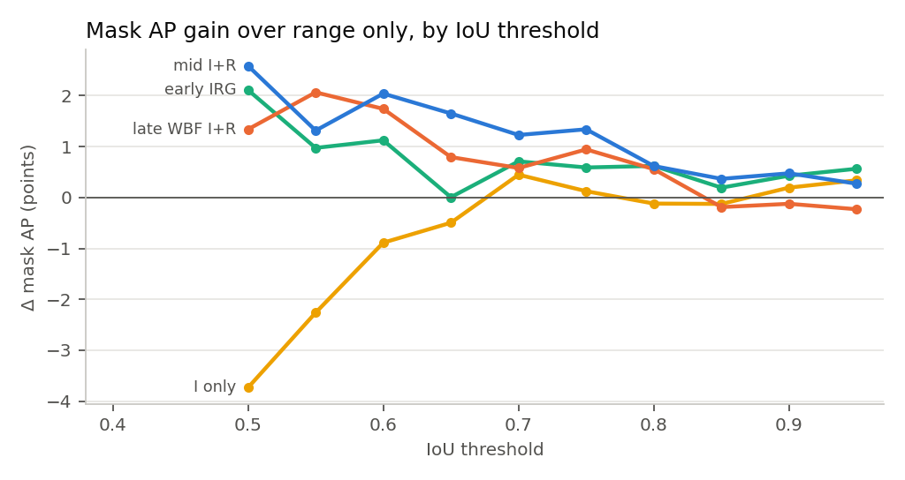
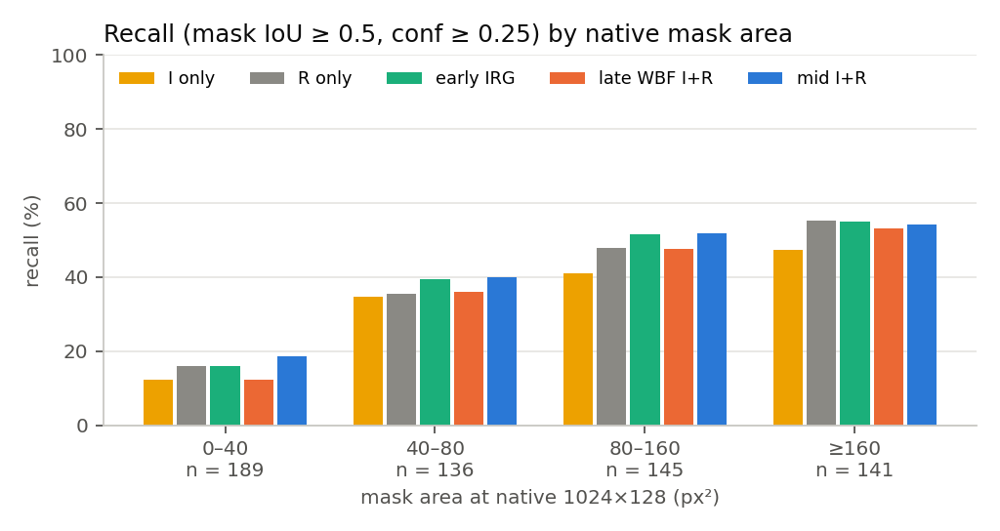
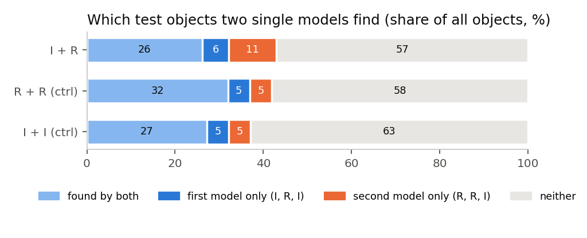
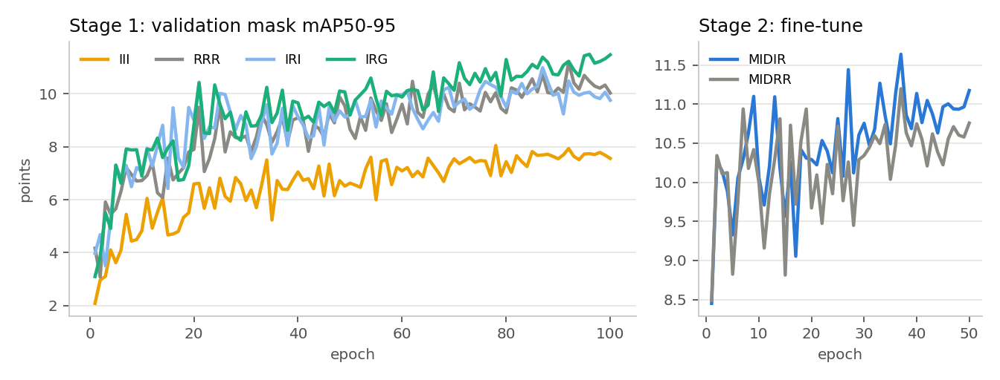

# Fusion study: analysis, comparison and next steps

Second-pass analysis of the intensity–range fusion experiments in this folder (`yolo11m-seg`, 640 px, seeds 0–2, 109 test frames). [README.md](README.md) reports which arm wins. This document asks why: where the gains come from, how robust they are, and what limits them. It ends with a ranked list of next steps.

New numbers come from [analyze_extra.py](analyze_extra.py) → [results/extra_yolo11m-seg_640.json](results/extra_yolo11m-seg_640.json) and [results/figures/](results/figures/). That script reuses the same checkpoints, the same Ultralytics validator pieces and the same test frames as `analyze.py`. It asserts that every re-scored run reproduces the cached `analyze.py` score exactly.

## Summary

1. **Fusion helps, by about 0.5 to 1.2 mask points, and the cause is intensity rather than extra capacity.** Every fused arm beats range-only on mask and box mAP. The duplicated-range controls (`MIDRR`, late `R+R`) do not.
2. **The ranking among fusion levels is not settled.** Under the default Ultralytics scorer, mid fusion (`MIDIR`) is best and the only arm whose interval clears zero. Rescored at 4× finer mask resolution, `MIDIR` and early fusion with a range gradient (`IRG`) are tied (Δ −0.24 [−0.90, +0.51]), and `IRG − RRR` is the only interval that clears zero. On validation, `MIDIR` and `IRG` are also tied (11.70 vs 11.65).
3. **The one result that holds on every test is `fence_pole`.** All fused arms gain +1.3 to +4.1 points on it, under both scoring grids. But 70 of the 95 test `fence_pole` instances come from one route (vt7), so a class effect cannot yet be separated from a route effect.
4. **The bottleneck is resolution, not modality.** At the operating point (confidence ≥ 0.25, mask IoU ≥ 0.5), 57% of test poles are missed by *both* the intensity and the range model. A perfect I + R oracle would find 42.9%, only 1.0 point more than two range models (41.9%). The 31% of poles under 40 px² are found 12–19% of the time by every arm.
5. **The default mask metric is very coarse for these objects.** Ultralytics scores masks on a 168 × 24 grid at 640 px. The median pole covers 4 cells there, 40% cover 3 or fewer, and 18 of 611 cover none, so no prediction can ever match those 18. On a 672 × 96 grid every mask mAP roughly halves (range only: 10.21 → 5.39), and `light_pole` mask AP collapses from about 14 to about 3.
6. **Fusion improves finding poles more than outlining them.** The mask gains sit at IoU 0.50–0.75 (`MIDIR` AP50 +2.6, AP75 +1.3) and vanish by IoU 0.85. Box mAP50 gains are +4 to +5.

**Recommendation.** Before testing more fusion designs, fix how masks are measured: score at a finer grid, add Boundary AP, and split by route. Then raise effective resolution: native-width input, finer prototypes, tiling. Then rerun the best two fusion designs (`IRG` and `MIDIR`) on top. Details and costs are in §6.

---

## 1. What was compared

| Arm | Fusion level | Input / design | Params | Inference |
|---|---|---|---:|---:|
| `III` | none | intensity in all 3 channels | 22.4 M | 1.1 ms |
| `RRR` | none | log-range in all 3 channels | 22.4 M | 1.1 ms |
| `IRI` | early | `[I, R, I]` | 22.4 M | 1.0 ms |
| `IRG` | early | `[I, R, ∂logR/∂col]` | 22.4 M | 1.0 ms |
| late WBF / NMS `I+R` | decision | `III` + `RRR` fused at test time; masks = score-weighted mean probability | 2 × 22.4 M | 2 models |
| `MIDIR` | mid | two-stream: range main + intensity aux backbone, zero-initialised 1×1 fusion at P3–P5, warm-started from `RRR`/`III`, +50 epochs | 34.3 M | 1.6 ms |
| controls | — | `MIDRR` (range in both streams), late `R+R`, late `I+I` (different seeds) | | |

Training, encoding and evaluation details are in [README.md](README.md). The planning documents and literature review behind the design are in [docs/](docs/).

## 2. Headline comparison

Mask mAP50-95, mean ± std over 3 seeds. The **default** column is the stock Ultralytics scorer (masks compared at imgsz/4, a 168 × 24 grid). The **fine** column re-scores the same predictions at the full letterboxed resolution (672 × 96): ground truth is rasterised there, and predicted masks are upsampled as in `ops.process_mask_native`. Late fusion builds its masks at prototype resolution, so it has no fine-grid score.

| Arm | Mask, default grid | Mask, fine grid | Box mAP50-95 | Recall @ conf .25, IoU .5 |
|---|---:|---:|---:|---:|
| `III` | 9.56 ± 0.12 | 4.08 ± 0.26 | 23.55 ± 1.28 | 32.2% |
| `RRR` | 10.21 ± 0.48 | 5.39 ± 0.23 | 26.31 ± 0.42 | 36.9% |
| `IRI` | 10.41 ± 0.24 | 6.02 ± 0.06 | **28.64 ± 0.40** | 37.4% |
| `IRG` | 10.94 ± 0.55 | **6.13 ± 0.30** | 28.52 ± 0.81 | 38.6% |
| late WBF `I+R` | 10.96 ± 0.17 | — | 28.51 ± 0.78 | 35.4%¹ |
| `MIDIR` | **11.40 ± 0.45** | 5.89 ± 0.17 | 28.32 ± 0.54 | **39.4%** |
| `MIDRR` (ctrl) | 10.34 ± 0.09 | 5.56 ± 0.31 | 27.19 ± 0.73 | 38.3% |

¹ WBF halves the score of a detection that only one model makes, so fewer late-fusion detections clear a fixed 0.25 threshold. Its recall at that threshold is not comparable to the single-model arms.

Paired differences, seed-mean Δ in mask points, with 95% bootstrap intervals over the 109 test frames (fine-grid bootstraps from `analyze_extra.py`, default from `results_yolo11m-seg_640.md`):

| Comparison | Default grid | Fine grid | `fence_pole`, fine grid |
|---|---|---|---|
| `MIDIR − RRR` | **+1.19 [+0.47, +1.87]** | +0.50 [−0.09, +1.02] | **+1.45 [+0.46, +2.39]** |
| `MIDIR − MIDRR` (modality, capacity held fixed) | **+1.05 [+0.44, +1.82]** | +0.33 [−0.01, +0.87] | **+1.87 [+0.93, +3.23]** |
| `IRG − RRR` | +0.73 [−0.23, +1.92] | **+0.73 [+0.03, +1.25]** | **+1.40 [+0.12, +2.86]** |
| `IRI − RRR` | +0.20 [−0.72, +1.34] | +0.63 [−0.07, +1.42] | **+1.27 [+0.11, +2.89]** |
| `MIDIR − IRG` | +0.46 [−0.59, +1.36] | −0.24 [−0.90, +0.51] | +0.05 [−1.03, +1.12] |
| `MIDRR − RRR` (capacity + epochs only) | +0.13 [−0.54, +0.75] | +0.16 [−0.38, +0.52] | −0.42 [−1.44, +0.28] |
| `RRR − III` | +0.65 [−0.83, +2.03] | **+1.31 [+0.49, +2.17]** | −0.77 [−2.08, +0.60] |

Bold marks intervals that exclude zero. Read together:

- **Intensity adds information, and capacity alone does not.** Both two-stream comparisons (`MIDIR − MIDRR`) favour the intensity stream on both grids, with P(Δ > 0) = 1.00 and 0.97. The capacity control is flat on both grids.
- **The size of the mid-fusion lead depends on the metric.** On the coarse grid `MIDIR` leads `IRG` by about half a point. On the fine grid `IRG` leads by a quarter. Neither interval excludes zero. The defensible claim is "early and mid fusion both beat range-only; their order is unresolved", not "mid fusion is best".
- **`IRG` is the cost-efficient choice.** It matches `MIDIR` on the fine grid and on validation at single-model cost (1.0 ms vs 1.6 ms), with one training stage instead of two.

## 3. What the second-pass analysis shows

### 3.1 Gains are in finding poles, not in outlining them

| Arm | Mask AP50 | Mask AP75 | Mask AP95 | Box AP50 | Box AP75 |
|---|---:|---:|---:|---:|---:|
| `RRR` | 28.51 | 6.74 | 1.08 | 50.56 | 25.58 |
| `IRG` | 30.62 | 7.33 | 1.64 | 55.94 | 27.04 |
| `MIDIR` | 31.10 | 8.08 | 1.35 | 54.85 | 26.66 |
| late WBF `I+R` | 29.85 | 7.68 | 0.85 | 55.43 | 26.79 |
| `III` | 24.78 | 6.86 | 1.41 | 46.43 | 21.58 |

Fusion lifts mask AP by 2–2.6 points at IoU 0.5, about 1 point at 0.75, and less than 0.6 points above 0.8. Box AP50 rises by 4–5 points. The fused models find and roughly place more poles, but mask quality at tight IoU is barely better than range-only. Intensity alone is 3.7 points worse than range at AP50 and level with it above IoU 0.7. Intensity's weakness is detection, not mask shape.

Mask mAP50-95 averages ten thresholds, and the top five contribute almost nothing for any arm. The headline metric is therefore driven mostly by AP50–AP75. Report AP50 and AP75 alongside it.

### 3.2 The scoring grid is coarser than the objects

Ultralytics' `SegmentationValidator` compares masks at prototype resolution, imgsz/4. A 1024 × 128 frame at `imgsz=640` becomes a 168 × 24 scoring grid, so one grid cell covers about 6 × 6 native pixels. Measured on the 611 test instances:

| Ground-truth size | Value |
|---|---|
| Native mask area, median (p10–p90) | 76 px² (17–320) |
| Native box width, median | 11 px |
| Cells on the scoring grid, median | 4 |
| Instances covering ≤ 3 cells | 242 (40%) |
| Instances covering ≤ 10 cells | 506 (83%) |
| Instances covering 0 cells (unmatchable) | 18 (3%) |

On a 4-cell object a one-cell error moves IoU by 0.2 or more, so AP at tight IoU thresholds is close to all-or-nothing. That explains the flat high-IoU tail in §3.1, and it is also why the coarse grid is lenient. A blob that covers a pole's few cells scores well there, even if it is twice the pole's width.

On the fine grid (672 × 96), every arm loses 42–57% of its mask mAP. The loss is largest for `light_pole`, the most frequent class (314 test instances), which has long thin shafts: about 14 → 3 for every arm. `traffic_pole` rises (range only 7.8 → 9.9). So the default metric hides that **most predicted light-pole masks are not pole-shaped at the resolution the network sees**. The prototype head (stride 4 relative to the 640-px input, about 6.4 native pixels per cell horizontally) cannot draw a 1–3 px shaft. The literature review flagged this as a possible mask-resolution ceiling ([docs/literature_review.md](docs/literature_review.md)), and these measurements confirm it.

### 3.3 Most poles are missed by every model; fusion moves recall by 2–3 points

| Native mask area | n | `III` | `RRR` | `IRG` | late WBF | `MIDIR` | `MIDRR` |
|---|---:|---:|---:|---:|---:|---:|---:|
| < 40 px² | 189 | 12.2 | 15.9 | 15.9 | 12.3 | 18.5 | 17.5 |
| 40–80 px² | 136 | 34.8 | 35.5 | 39.5 | 36.0 | 40.0 | 36.3 |
| 80–160 px² | 145 | 41.1 | 47.8 | 51.5 | 47.6 | 52.0 | 51.3 |
| ≥ 160 px² | 141 | 47.3 | 55.3 | 55.1 | 53.2 | 54.1 | 54.8 |

Recall in %, confidence ≥ 0.25, best same-class mask IoU ≥ 0.5, mean of 3 seeds (seed std 0.4–3.2 points).

- **Recall is low at every size.** It peaks at 55% for the largest quarter of poles and is 12–19% for the smallest third.
- **Fusion helps the middle sizes (40–160 px²) by 4–5 points** and does nothing for the largest. In the smallest bin `MIDIR` gains 2.6 over range, but `MIDRR` gains 1.6 without intensity, so most of that comes from the extra stage-2 training rather than from intensity.
- Fused models find poles with the same mask quality as range-only (mean IoU of found objects 0.69–0.71 for every arm).

### 3.4 Intensity's unique contribution is real but small, and concentrated on `fence_pole`

For each test object, the analysis asks whether the intensity model and the range model of the same seed each find it. The same split is shown for two range models and two intensity models with different seeds, which is the level of disagreement expected from seed noise alone.

| Pair | Both | First only | Second only | Neither | Union (oracle recall) |
|---|---:|---:|---:|---:|---:|
| `III` + `RRR` | 26.2% | 6.0% (I) | 10.7% (R) | 57.1% | 42.9% |
| `RRR` + `RRR` (other seed) | 32.0% | 5.0% | 5.0% | 58.1% | 41.9% |
| `III` + `III` (other seed) | 27.2% | 5.0% | 5.0% | 62.8% | 37.2% |

- Objects that only the intensity model finds are 6.0% of the test set. Seed noise alone produces 5.0% (one range model finding what another misses). Across all classes, intensity's unique contribution is therefore **about one point of recall**, which matches the oracle: I ∪ R is 42.9% against R ∪ R at 41.9%.
- **`fence_pole` is the exception.** There, intensity alone finds 8.1% of objects that range misses, and range alone finds only 4.2% that intensity misses. For `traffic_pole` the opposite holds (5.1% vs 18.8%). This is the per-class complementarity that motivated the study, now measured per object rather than inferred from per-class AP.
- **Of the objects only intensity finds, the fused arms recover:** `MIDIR` 47%, `IRG` 45%, late WBF 43%, `IRI` 40%. The control `MIDRR`, which sees no intensity, recovers 30%, which is the share any extra model would pick up through seed variation. So `MIDIR` keeps roughly 17 points more of the intensity-only objects than chance, `IRG` about 15.
- **The headroom from fusion alone is small.** 57% of objects are found by neither modality. If fusion recovered every object either single model finds, recall would rise from 36.9% to 42.9%. Raising recall beyond that needs better detection of small objects (§6 B).

### 3.5 Route effects and the `fence_pole` confound

Mask mAP50-95 per survey route, mean of 3 seeds, default grid. Routes with few frames are noisy, so treat these as descriptive; no intervals are given.

| Route | Frames | Instances | Classes (test) | `III` | `RRR` | `IRG` | late WBF | `MIDIR` | `MIDRR` |
|---|---:|---:|---|---:|---:|---:|---:|---:|---:|
| Hava_E18 | 29 | 80 | light 51, fence 15, traffic 12, gantry 2 | 12.9 | 14.3 | 15.9 | 15.7 | 15.9 | 12.5 |
| vt7 | 26 | 151 | **fence 70**, light 51, traffic 18, gantry 12 | **9.1** | 6.1 | 7.3 | 7.8 | 7.6 | 6.9 |
| University–tuira–isko | 23 | 210 | light 108, gantry 54, traffic 48 | 9.3 | 11.3 | 11.6 | 10.7 | 11.1 | 12.2 |
| vt22 | 12 | 44 | light 42, gantry 2 | 20.2 | 17.4 | 18.2 | 20.7 | 19.4 | 18.7 |
| x200go | 10 | 73 | light 45, traffic 28 | 8.5 | **15.5** | 14.8 | 13.7 | 13.9 | 14.7 |
| Knuutilanranta | 5 | 23 | fence 10, traffic 8, light 5 | 10.7 | 8.1 | 11.8 | 12.4 | 13.2 | 9.6 |
| isko–university | 4 | 30 | light 12, traffic 10, gantry 8 | 12.6 | 15.7 | 14.3 | 15.4 | 15.1 | 13.9 |

- The modality preference flips by route. Intensity wins on vt7, vt22 and Knuutilanranta, and range wins clearly on x200go and the University routes.
- **74% of the test `fence_pole` instances (70 of 95) are on vt7**, the route where intensity is strongest overall. The study cannot tell whether intensity helps fence poles in general or helps on vt7 in general. The route and class splits need to be broken apart (§6 A2).
- No fused arm wins every route. On the two University routes, range-only or `MIDRR` matches or beats every arm that uses intensity.

### 3.6 Training dynamics

| Arm | Epoch of peak val mask (mean) | Val mask at selected `best.pt` | Val, last 10 epochs |
|---|---:|---:|---:|
| `III` | 87 / 100 | 8.12 | 7.70 |
| `RRR` | 82 / 100 | 11.29 | 10.38 |
| `IRI` | **61** / 100 | 10.93 | 9.93 |
| `IRG` | 89 / 100 | 11.65 | 11.20 |
| `MIDIR` | 30 / 50 (+100) | 11.70 | 10.93 |
| `MIDRR` | 30 / 50 (+100) | 11.31 | 10.52 |

- Validation curves are noisy from epoch to epoch (±1 point). `best.pt` is chosen on this noisy curve from 109 validation frames, which adds selection noise to every test number.
- `IRI` peaks early and then drifts down, which suggests overfitting. `IRG` keeps improving to the end and may gain from longer training.
- On validation, the order is `MIDIR` ≈ `IRG` > `MIDRR` ≈ `RRR` > `IRI` ≫ `III`, with gaps of about 0.4 points. That agrees with the fine-grid test result and is smaller than the default-grid test gap.
- Stage 2 starts *below* its warm start: epoch-1 validation is 8.45 against `RRR`'s 10.4. The augmentation and learning-rate restart perturb the converged model, and it needs about 7 epochs to recover.

## 4. Verdict per fusion level

| Level | README claim | After this analysis |
|---|---|---|
| Early, `IRI` | No mask gain over range | Small gain on the fine grid (+0.63, interval just includes 0). Largest box gain (+2.3). Peaks early, possibly overfitting |
| Early, `IRG` | No significant mask gain | **Ties mid fusion** on the fine grid and on validation, at single-model cost. The best cost/benefit arm |
| Late, WBF/NMS | No significant gain; ensembling explains part | Unchanged. Its `fence_pole` gain is real, but it does not beat early fusion, and its fixed-threshold recall suffers from score dilution. Calibrated fusion (ProbEn) was not tested |
| Mid, `MIDIR` | Only robust mask gain; best arm | Gain over its capacity control holds on both grids (P(Δ>0) ≥ 0.97). Its lead over range and over `IRG` depends on the scoring grid. Highest recall and the most intensity-only objects recovered, at 1.5× inference cost |
| Class-aware late | Did not help | Unchanged. Tuning per-class weights on 109 validation frames is too noisy |

**How the results compare with the literature review's predictions.** The review ([docs/literature_review.md](docs/literature_review.md)) predicted a gain of one to two mask points and early fusion at least matching mid fusion at about 1k training images. Both held. It also predicted multi-stage mid fusion would be risky at small data. That risk did not materialise here, probably because `MIDIR` is the "safe" form of mid fusion: zero-initialised fusion, branches warm-started from PoleSight checkpoints, and a model identical to range-only at step 0. The review cited this ControlNet-like MCF design as one that is built never to fall below its base. Late fusion did not beat learned fusion, unlike ProbEn's results on KAIST and FLIR. The late arms here use WBF score averaging without calibration, which ProbEn reports as the failure case, so the strongest form of late fusion has not been tested yet.

## 5. Things the study cannot claim yet

- That mid fusion is better than early fusion: the order flips with the scoring grid, and neither interval excludes zero.
- That intensity helps `fence_pole` as a class: the class is confounded with route vt7.
- That any fused arm draws better masks: gains are at IoU ≤ 0.75 and mean IoU of found objects is unchanged.
- That the 8-bit encoding helps by itself: `RRR` (10.21 ± 0.48) and `III` (9.56 ± 0.12) bracket the published stock-loader numbers for `yolo11m-seg` (10.70 and 9.31, one seed, different GPU, `results/result.md`).
- Anything at native resolution or for other model scales: only `yolo11m-seg` at 640 was run.

## 6. Next steps, ranked

Ordered by what each step unlocks per hour of compute. Stage-1 runs take about 28 min each on the RTX 4500 Ada at 640 px. Hours at 1024 px are estimates, not measurements.

### A. Fix the measurement first (cheap, required for any further claim)

| # | Step | Why | Cost |
|---|---|---|---|
| A1 | **Report masks at a fine grid and add Boundary AP.** Keep the stock metric for comparison with `results/`, add the fine-grid score (`analyze_extra.py` already computes it) and Boundary AP ([Cheng et al., CVPR 2021](https://arxiv.org/abs/2103.16562); [boundary-iou-api](https://github.com/bowenc0221/boundary-iou-api)). Report AP50 and AP75 next to AP50-95 | The default grid flips the early-vs-mid ranking (§2) and hides that light-pole masks are not pole-shaped (§3.2). Boundary IoU is designed for this: it reacts to boundary errors without over-penalising small objects | Evaluation only |
| A2 | **Break the route/class confound.** Report per class within route vt7 and outside it. Run leave-one-route-out or route-grouped cross-validation for `RRR`, `IRG`, `MIDIR` | 74% of test `fence_pole` instances are on one route (§3.5). The project's main complementarity claim rests on it | Eval: free. CV: about 5 folds × 3 arms |
| A3 | **More seeds for the three arms that matter** (`RRR`, `IRG`, `MIDIR` + `MIDRR`), 5 seeds | Seed std is 0.2–0.6 points, the same size as the differences in question. Two more seeds per arm is about 4 h | About 4–5 h |
| A4 | **Calibrated late fusion.** Temperature-scale each detector on validation, then ProbEn-style fusion ([Chen et al., ECCV 2022](https://arxiv.org/abs/2104.02904)) | WBF score averaging is the form ProbEn found to fail. The strongest late-fusion baseline is untested | Evaluation only |

### B. Raise the resolution ceiling (the largest expected lever)

57% of poles are missed by both modalities and the smallest third are found 12–19% of the time (§3.3–3.4). Fusion cannot fix that. Resolution changes moved published thin-object results by 5–15 points, against 1–3 for fusion ([docs/literature_review.md](docs/literature_review.md), "Resolution outweighs the fusion operator").

| # | Step | Why | Cost |
|---|---|---|---|
| B1 | **Native width: `imgsz=1024`, rectangular batches** for `RRR`, `IRG` and then `MIDIR`/`MIDRR`. This is the Tier 0 step in [docs/fusion_sota.md](docs/fusion_sota.md) §1.1 that was never run | Removes the 0.625× downscale. The scoring grid and prototypes go from 168 × 24 to about 256 × 32. Every fusion number should be re-measured on top of it | ≈ 6 runs × ~1 h (estimate) |
| B2 | **Anisotropic upscale or horizontal tiling.** Train on 1024 × 256 (2× vertical), or on overlapping 256–512 px-wide crops tiled into a square canvas (as Casado-Coscolla et al. did for Ouster 1024 × 128) | Poles are vertical and thin, so horizontal resolution decides whether the shaft exists. 128 rows become 80 at 640 px | Data-loader change + 3–6 runs |
| B3 | **Finer prototypes.** Train with `mask_ratio=2` or `1` (ground truth rasterised finer) and add an extra ×2 upsampling stage to the proto head, or build a stride-4 (P2) `-seg` YAML | The proto head is the hard limit on mask shape (§3.2). The installed Ultralytics ships P2 YAMLs only for detection | Custom YAML/head + 3–6 runs |
| B4 | **Point-based mask refinement on uncertain pixels** (PointRend-style; [Mask Transfiner](https://arxiv.org/abs/2111.13673) reports +3.0 mask AP on COCO and +6.6 boundary AP on Cityscapes by refining only error-prone quadtree nodes) | Gives thin-structure masks native-resolution detail without running the whole network at high resolution. It can read both I and R at the refined points, which is a natural place for fusion | Research-level implementation |
| B5 | **Small-object label assignment.** Try YOLO26's STAL, described as guaranteeing positive coverage for small objects ([YOLO26](https://arxiv.org/abs/2606.03748)), or an NWD-based assigner | IoU-based assignment degrades for tiny boxes. Caveat: YOLO26-seg scored *below* YOLO11 on PoleSight with stock loading (`yolo26m-seg` 9.30 vs 10.70 range), so test it as a factor, not a replacement | 3–6 runs |

### C. Fusion design, once B has moved the baseline

| # | Step | Why |
|---|---|---|
| C1 | **Combine the two winners:** a `MIDIR`-style two-stream whose main stream takes `IRG` instead of `RRR`, with the aux stream on intensity, or `IRG` with a single fusion node | `IRG` and `MIDIR` each recover about 45% of the intensity-only objects by different means (input gradient vs a second backbone). Whether they recover the same objects, and whether the gains add, is the cheapest open fusion question |
| C2 | **Fuse at stride 4 (P2), not only at P3–P5** | At P3 a pole is already under one cell (§3.2). The review recommends learned fusion at stride ≤ 4 |
| C3 | **Ablate the `MIDIR` recipe**: warm start vs COCO start, frozen main stream (MCF-style) vs fine-tuned, concat-1×1 vs gated or CMX-lite fusion, and fine-tune length (best epoch was about 30 of 50). Every variant needs its `RR` control | The recipe was fixed before the runs and never tuned (README, "How far to trust this") |
| C4 | **Unimodal auxiliary heads and modality dropout** on the two-stream model | Keeps the intensity branch useful by itself (the `fence_pole` cue). The review advises against gradient-balancing methods (OGM-GE) when one modality dominates |
| C5 | **Distil `MIDIR` into a single-stream `IRG` or `RRR` student** (2DPASS-style) | Recovers the 1.5× inference cost. Distillation from a fused teacher is the best-evidenced route to fusion-level accuracy in a single-modality model |

### D. Data and training recipe

| # | Step | Why |
|---|---|---|
| D1 | **Range-view augmentation:** horizontal roll of the 360° frame, row-band mixing, same-row instance copy-paste with I and R moved together | The largest gains in the range-view literature (+2.5 to +7 mIoU over standard augmentation). Untested on 2D instance segmentation, so PoleSight would be first evidence |
| D2 | **Encoding as a factor:** log vs linear vs histogram-equalised range, and a 16-bit path via a custom `preprocess` | The 8-bit packing did not measurably beat stock loading (§5). Thermal detection shows encoding choice moving results by up to 12.8 mAP |
| D3 | **Validity-mask channel** (`[I, R, valid]` and `[R, R, valid]` control) | The cheapest channel with good prior evidence for small, ragged objects (SalsaNet, SqueezeSegV2). About half of each frame is no-return |
| D4 | **More `fence_pole` data from other routes** | Needed to settle §3.5. It also helps the class with the lowest mask AP on the fine grid |

### Suggested order

1. **A1 + A2 (evaluation)** on the existing checkpoints: re-tabulate with fine-grid, Boundary AP and route-split numbers. No training.
2. **A4 (calibrated late fusion):** evaluation only.
3. **B1 at 1024 px** for `RRR` and `IRG`, 3 seeds, then `MIDIR`/`MIDRR` from those checkpoints. This answers whether fusion still matters once resolution is fixed.
4. **B3 (finer prototypes)** on the best of step 3.
5. **C1 / C2** on top, with **A3** seeds for the final comparison.

## 7. Limitations of this analysis

- "Found" uses a fixed confidence of 0.25 and the best same-class mask IoU, without one-to-one matching. It is a recall diagnostic, not a replacement for AP.
- The fine grid is the letterboxed 640-px input (672 × 96), not native 1024 × 128. Predicted masks are bilinear upsamplings of 168 × 24 prototypes, so the fine-grid score measures how well the prototypes describe the shape, not a native-resolution model.
- Fine-grid bootstraps use 300 draws, as in `analyze.py`. Route results have no intervals and some routes have 4–5 test frames.
- All analyses reuse the 3 seeds and the 109 test frames. Nothing here adds training variance information.

## 8. Research basis

A full `deep-research` pipeline was not re-run. [docs/literature_review.md](docs/literature_review.md), [docs/fusion_sota.md](docs/fusion_sota.md) and the six notes in [docs/research_notes/](docs/research_notes/) already cover fusion stage, range-view channels, small-object detection and training strategy, with sources checked against full text where marked. For questions these results newly raised, targeted searches added three sources:

- Boundary IoU / Boundary AP, for scoring thin masks: Cheng, B., Girshick, R., Dollár, P., Berg, A. C., & Kirillov, A. (2021). *Boundary IoU: Improving object-centric image segmentation evaluation*. CVPR. https://arxiv.org/abs/2103.16562
- Sparse mask refinement: Ke, L., Danelljan, M., Li, X., Tai, Y.-W., Tang, C.-K., & Yu, F. (2022). *Mask Transfiner for high-quality instance segmentation*. CVPR. https://arxiv.org/abs/2111.13673
- Small-object label assignment (STAL) in YOLO26: *Ultralytics YOLO26: Unified real-time end-to-end vision models* (2026). https://arxiv.org/abs/2606.03748 (abstract only; the segmentation-head details were not verified)

## 9. Files

| File | Content |
|---|---|
| [analyze_extra.py](analyze_extra.py) | The analyses in this document; per-object records and fine-grid scores cached as `cache/obj_*.pkl` |
| [results/extra_yolo11m-seg_640.json](results/extra_yolo11m-seg_640.json) | Every number above |
| [results/figures/](results/figures/) | `ap_by_iou.png`, `recall_by_size.png`, `complementarity.png`, `training_curves.png`, `scoring_grid.png` |
| [docs/](docs/) | The plan (`fusion.md`), method ranking (`fusion_sota.md`), literature review and research notes, moved here from the repository root |

Reproduce: `source fusion/env.sh && $PY fusion/analyze_extra.py` (after `analyze.py`; about 15 min on the RTX 4500 Ada the first time; cached afterwards).
